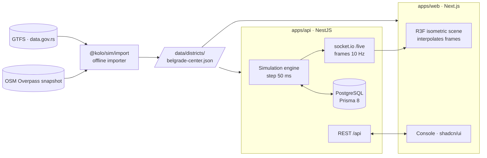

# 🚕 Kolo

**A live, isometric 3D control room for a taxi aggregator, built on top of a real, simulated Belgrade.**

[](https://nextjs.org)
[](https://react.dev)
[](https://r3f.docs.pmnd.rs)
[](https://nestjs.com)
[](https://www.prisma.io)
[](https://www.postgresql.org)
[](https://www.typescriptlang.org)
[](https://github.com/Qialet/kolo/actions/workflows/tests.yml)
[](LICENSE)

🇬🇧 English | [🇷🇺 Русский](README.ru.md)

<p align="center">
  
</p>

> Every building, street, lane, traffic light, crosswalk, bus stop and tram track in this picture comes
> from real open data for central Belgrade. Every vehicle is simulated on the server, 20 times a second.

---

## 🏙️ What is this?

Kolo (*"wheel"* in Serbian, and the name of the Serbian round dance) started as a **dispatcher dashboard
for a taxi aggregator** in the spirit of Yandex Go or Uber. The aggregator owns no cars; partner fleets
own the parks, the cars and the service bays. The aggregator takes orders, dispatches them and watches
everything live.

The brief asked for an isometric city where taxis drive, stop at traffic lights and pick up passengers.
The first version used a procedurally generated "Vračar". Then the project outgrew it. **The fake city was
replaced with ~5 km² of real central Belgrade**, from Kalemegdan to the Temple of Saint Sava. After that
the project took on a second, much bigger goal: **reproduce the city's public transport** (buses,
trolleybuses, electric minibuses and trams) on the real network, running on the official GSP timetable.

The result is half admin panel and half city simulator. You can click any taxi, bus, tram, stop,
traffic light, building or depot to see what it is doing and why, and you can change what the city does.

## 📸 Screenshots

<p align="center">
  
  
</p>
<p align="center">
  
  
</p>
<p align="center">
  
  
</p>
<p align="center">
  
  
</p>
<p align="center">
  
</p>

## ✨ Highlights

### A real city, rebuilt offline from open data
- **6,300 OSM buildings** extruded to their real height; a window grid in the shader follows each building's actual floor height.
- **Road graph from OSM `highway`**: lane counts, one-ways, `turn:lanes`, ~400 turn restrictions, `maxspeed`, bus-only lanes, roundabouts, bridges and tunnels **by layer**, with ramps, piers and parapets.
- **282 traffic signals → 101 signalised junctions**, plus `give_way` / `stop` signs and right-hand priority where nothing is signed.
- **916 mapped crosswalks**, parks, trees, playgrounds, the Sava, pedestrian streets and park paths.
- One versioned **district file** (~2.8 MB) is shared by the server and the browser, so the network only carries moving things.

### Traffic that behaves
- **IDM** car following with per-driver parameters and curve speed limits.
- **MOBIL** lane changes with courtesy to followers, lane preparation before turns, and turn signals blinking in 3D.
- Pre-computed junction conflicts, "don't block the box", yielding on left turns, full stops at STOP signs, amber dilemma-zone logic, and deadlock breakers.
- Up to **300 background cars**; a 10-minute soak test without collisions or gridlock.

### Public transport on the real timetable
- **GTFS of GSP Beograd** (data.gov.rs): ~110 bus, 6 trolleybus and 10 tram lines and ~22,000 weekday trips inside the frame.
- Vehicles depart by the schedule on a **Belgrade clock**, with weekday / Saturday / Sunday / holiday services; Serbian holidays are computed, Orthodox Easter included.
- **Trams** run on real tracks: CAF Urbos 3 (5 sections) and Tatra KT4, rails, ballast, overhead wire and platforms. Where the track lies in the street, they share the lane with cars.
- **Trolleybuses** carry two poles under real `trolley_wire` overhead lines. Bus bays come from OSM or a heuristic; a bus without a bay stops in its lane, and cars change lanes to get around it.
- Stops show the next departures; lines show both directions, ordered stops, median headway and the vehicles on the line; each vehicle shows "on time / N min late".

### A taxi aggregator that actually dispatches
- **60 taxis in 3 partner fleets** parked in real yards, with drivers, ratings, service bays, breakdowns and repairs.
- **Demand is weighted by the city itself**: bus stops by trips this hour, places of interest by type, addresses by floor area.
- The full order lifecycle: search → offer (15% of offers missed) → assign → pickup → trip → complete, plus cancel, no-show, expiry and **passenger disputes** with refunds.
- A fare model in RSD (base + per km + per minute), live ETA, and leg progress measured by odometer.

### A dispatcher's console
- Clicking a taxi shows its route, A/B pins, ETA, order, passenger, fare and a step tracker.
- Admin controls: create, assign or cancel an order; change a car's status; resolve disputes; flash or hold a traffic light; change simulation speed, traffic density and demand.
- **Ctrl+K search** across taxis, orders, parks, lines, stops and addresses; a partner filter that fades everyone else's cars; a live event feed and KPI cards.
- Responsive from desktop down to a phone with a bottom-sheet inspector.

### Built to stay fast
- LOD, culling and instancing took the frame from **3.2 M triangles down to 0.44–0.78 M**; a server simulation step costs **~0.4–1.2 ms** against a 16.7 ms budget.
- `pnpm perf --budget` fails the run when a view goes over its draw-call or triangle budget, and `road-audit` measures road-geometry defects and renders top-down maps.

## 🧭 How it works



- **The server is authoritative.** `packages/sim` is a deterministic, dependency-free TypeScript engine. The API runs it, persists business events (orders, disputes, status changes) and broadcasts compact frames.
- **The client rebuilds the same city** from the same district file, interpolates 10 Hz frames into smooth 60 fps motion, and polls REST only for the details of the selected object.
- **Data stays offline.** OSM and GTFS are imported once; nothing is fetched from third-party APIs at runtime.

## 🛠️ Tech stack

| Layer | Technology |
|---|---|
| Monorepo | pnpm 12 workspaces · Turborepo · TypeScript 6 |
| Frontend | Next.js 16 (App Router) · React 19 + React Compiler · Tailwind CSS 4 · shadcn/ui on Base UI · TanStack Query · Zustand |
| 3D | three.js · React Three Fiber · drei; orthographic isometric camera, custom shaders, instancing, LOD |
| Backend | NestJS 12 (ESM) · socket.io · zod |
| Database | PostgreSQL 18 · Prisma ORM 8 (contract-first) |
| Simulation | `@kolo/sim`: pure TypeScript with no runtime dependencies; IDM, MOBIL, Dijkstra over lanes, signal plans, GTFS scheduler |
| Testing | Vitest · Node test runner · Playwright-driven frame-budget probe |
| Data | OpenStreetMap (ODbL) · GTFS GSP Beograd (Serbian Open Data License) |

## 🚀 Quick start

**Prerequisites:** Node.js 25, pnpm 12, PostgreSQL 15+ on `localhost:5432`.

```bash
pnpm install

# API config: copy the example and adjust DATABASE_URL if needed
cp apps/api/.env.example apps/api/.env
createdb -U postgres kolo
pnpm --filter @kolo/api migrate      # applies apps/api/migrations

pnpm dev                              # API on :4000, web on :3000
```

Open <http://localhost:3000>. An empty database is seeded automatically on first start
(partners, parks, 60 taxis and drivers).

```bash
pnpm test     # all packages
pnpm build    # everything
cd apps/web && pnpm perf --budget   # frame budget, with pnpm dev running
```

<details>
<summary>Rebuilding the district from raw data</summary>

The committed `data/districts/belgrade-center.json` is all the app needs. To regenerate it, put an
Overpass export and the GSP GTFS feed into `data/raw/` (kept out of git) and run
`pnpm --filter @kolo/sim import:district`. `node packages/sim/scripts/road-audit.mjs --map` prints
road-geometry metrics and draws top-down maps.
</details>

## 📁 Repository layout

```
kolo/
├─ apps/
│  ├─ api/          NestJS: simulation host, socket.io gateway, REST, Prisma contract & migrations
│  └─ web/          Next.js: isometric scene (components/scene) and console (components/console)
├─ packages/
│  ├─ sim/          city builder, road graph, traffic, transit, demand, importer (pure TS)
│  └─ contracts/    shared enums, WebSocket wire format, zod REST schemas
├─ data/districts/  the versioned Belgrade district file
├─ docs/            agent-facing docs: architecture, domain, design, simulation, roadmap
│  └─ superpowers/  the design spec and the ten implementation plans the project was built from
└─ screenshots/
```

## 🤖 How it was built: human orchestration and Claude Code

**This project contains no hand-written code.** It was built in **5 days and 115 commits**, about 19k
lines of TypeScript and 250+ tests, by one person orchestrating
[Claude Code](https://claude.com/claude-code) running **Claude Opus 5.5**.

The split of roles:

- **The human is the product owner and orchestrator.** They wrote the original brief, made every
  product and architecture call (real Belgrade instead of a procedural city, schedule-based transit
  instead of unavailable GPS, the stack, the brand), reviewed the 3D output and redirected the work.
- **Claude Code is the engineering team.** It researched the data sources, designed and implemented
  the code, wrote the tests, profiled, verified its work visually and committed it.

The workflow ran on the **[Superpowers](https://github.com/obra/superpowers)** plugin, which enforces
a disciplined loop for every change:

1. **Brainstorming:** clarifying questions and options until the design is agreed
   ([`docs/superpowers/specs`](docs/superpowers/specs)).
2. **Writing plans:** each stage is broken into small tasks with tests; there are ten plans in
   [`docs/superpowers/plans`](docs/superpowers/plans), covering roads, places, transit, trams,
   performance, demand, priority, lane changes, bus bays and road geometry.
3. **Subagent-driven development:** tasks are dispatched to sub-agents and reviewed between steps
   (TDD, code review, verification before completion).
4. **Verification with evidence:** tests, `road-audit` metrics, `perf --budget`, and headless-Chrome
   screenshots driven through dev hooks (`window.__koloUi`, `__koloFrames`, `__koloGl`).

The agent also worked with **official agent skills** for the tools in use:
[`shadcn`](https://ui.shadcn.com), Vercel's
[`react-best-practices`](https://github.com/vercel-labs/agent-skills), Prisma's `prisma-orm-setup`, and
the `prisma-8` skill that ships inside `@prisma/orm-postgres`. They are not vendored in this repository;
`skills-lock.json` pins them, and `prisma skills sync` restores the Prisma one.

**Context survives across sessions** through [`CLAUDE.md`](CLAUDE.md) and a set of short agent-facing
docs in [`docs/`](docs). Each is under 100 lines, contains no code, and holds no change history. The
checkboxes in [`docs/ROADMAP.md`](docs/ROADMAP.md) plus `git log` are the source of truth, so any new
chat can pick up where the last one stopped, for example after hitting usage limits.

## 🗺️ What's next

Ideas that fit the current architecture:

- **Driver emulator:** accept or skip offers by hand, from a phone-sized driver view.
- **Demand heatmap and surge pricing:** a grid of demand cells with price multipliers.
- **Day and night:** headlights, lit windows, and traffic and demand curves that follow the time of day.
- **Roles and auth:** aggregator admin, fleet manager (sees only their park), dispatcher.
- **Telemetry and replay:** store tracks (TimescaleDB or partitioning) and rewind the last hour around a disputed order.
- **Pedestrians** on the 900+ real crosswalks, interacting with turning traffic.
- **More Belgrade:** extend the frame across the Sava to New Belgrade and Zemun; the importer and LOD were built for it.
- **Weather and incidents:** rain that slows traffic, road closures and their effect on ETAs.
- **Real feeds:** partner-fleet telematics instead of simulated taxis, and transit GPS if GSP ever opens it.
- **API and QA:** OpenAPI/Swagger for the REST API and Playwright scenarios in CI.

## 📜 License and data

The source code is licensed under the [MIT License](LICENSE).

The district file is derived from third-party open data:

- Map data © [OpenStreetMap contributors](https://www.openstreetmap.org/copyright), available under the
  [Open Database License (ODbL)](https://opendatacommons.org/licenses/odbl/). The derived district
  database in `data/districts/` is shared under the same licence.
- Timetable: GTFS «Градски јавни превоз у Београду», Grad Beograd, via
  [data.gov.rs](https://data.gov.rs), under the Serbian Open Data License.

Partner fleets, drivers, passengers and orders are fictional. Kolo is a demo and is not affiliated with
GSP Beograd, Yandex, Uber or any taxi company.
