# 🚕 Kolo

**Живая изометрическая 3D-диспетчерская агрегатора такси поверх настоящего, симулированного Белграда.**

[](https://nextjs.org)
[](https://react.dev)
[](https://r3f.docs.pmnd.rs)
[](https://nestjs.com)
[](https://www.prisma.io)
[](https://www.postgresql.org)
[](https://www.typescriptlang.org)
[](https://github.com/Qialet/kolo/actions/workflows/tests.yml)
[](LICENSE)

[🇬🇧 English](README.md) | 🇷🇺 Русский

<p align="center">
  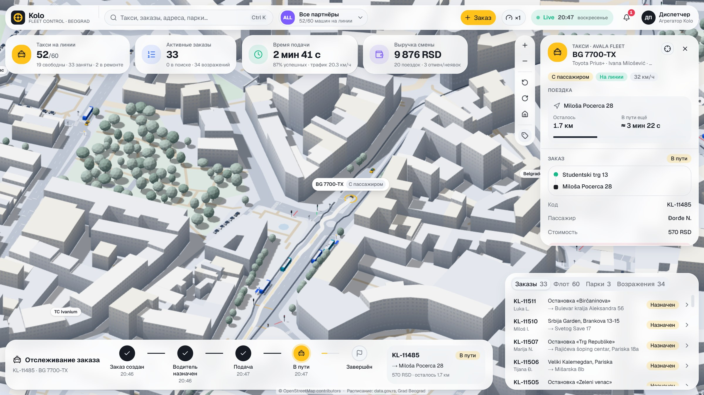
</p>

> Каждое здание, улица, полоса, светофор, зебра, остановка и трамвайный путь на этой картинке взяты
> из открытых данных о центре Белграда. Каждая машина симулируется на сервере 20 раз в секунду.

---

## 🏙️ Что это?

Kolo («колесо» по-сербски, а ещё сербский хоровод) начинался как **диспетчерская панель агрегатора
такси** в духе Яндекс Go или Uber. У агрегатора нет своих машин: парки, автомобили и сервисные боксы
держат компании-партнёры. Агрегатор принимает заказы, распределяет их и следит за всем в реальном времени.

По брифу нужен был изометрический город, где такси ездят, стоят на светофорах и забирают пассажиров.
Первая версия работала на процедурно сгенерированном «Врачаре», но проект быстро его перерос.
**Выдуманный город заменили на ~5 км² настоящего центра Белграда**, от Калемегдана до Храма Святого
Саввы. Дальше появилась вторая, куда более амбициозная цель: **воспроизвести городской транспорт**
(автобусы, троллейбусы, электрические маршрутки и трамваи) на реальной сети по официальному расписанию ГСП.

В итоге получилась наполовину админка, наполовину симулятор города. Кликни на любое такси, автобус,
трамвай, остановку, светофор, здание или парк, и увидишь, что объект делает и почему. Поведение города
тоже можно менять.

## 📸 Скриншоты

<p align="center">
  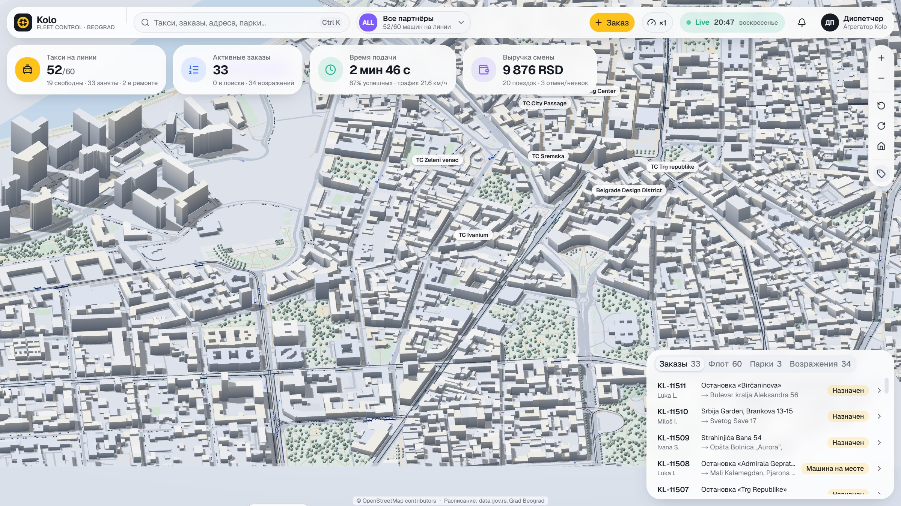
  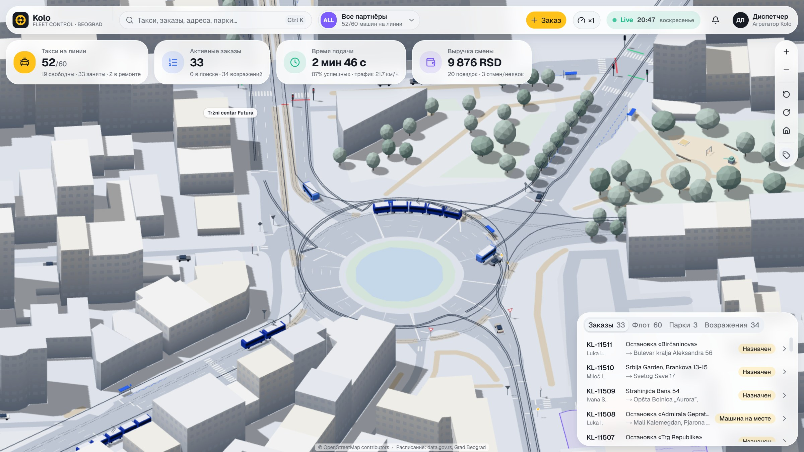
</p>
<p align="center">
  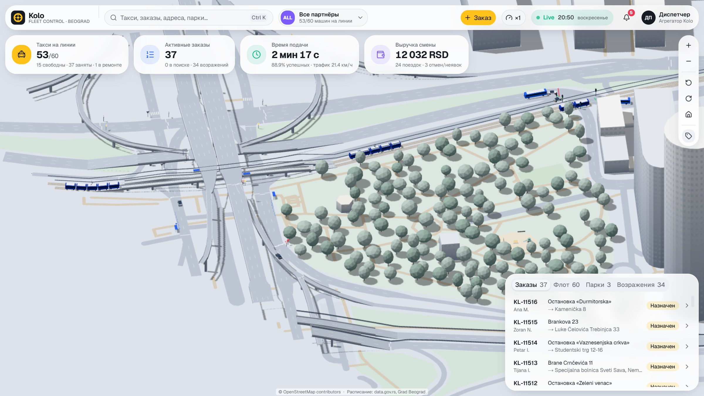
  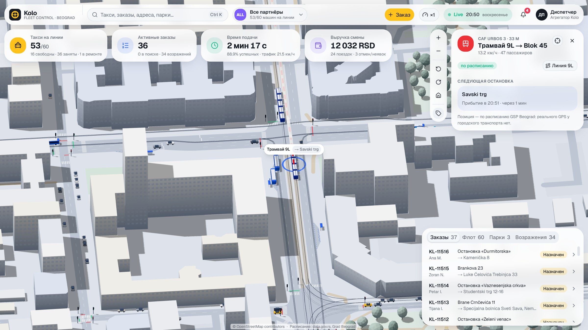
</p>
<p align="center">
  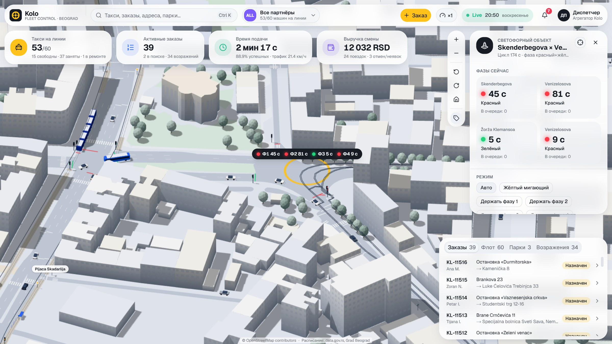
  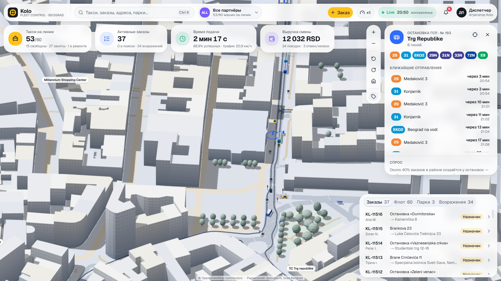
</p>
<p align="center">
  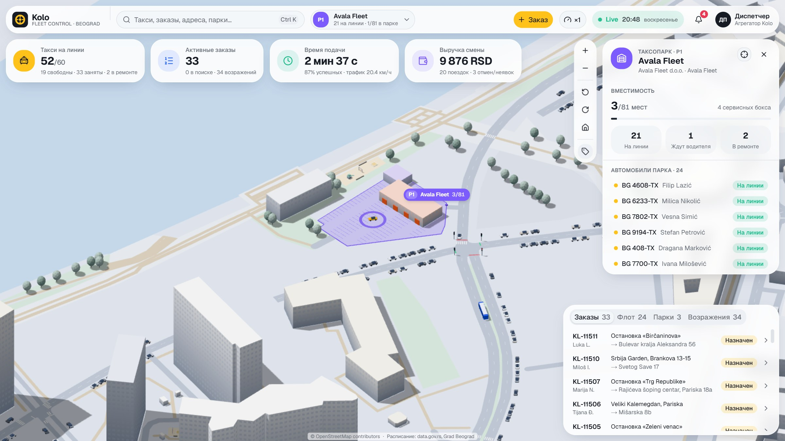
  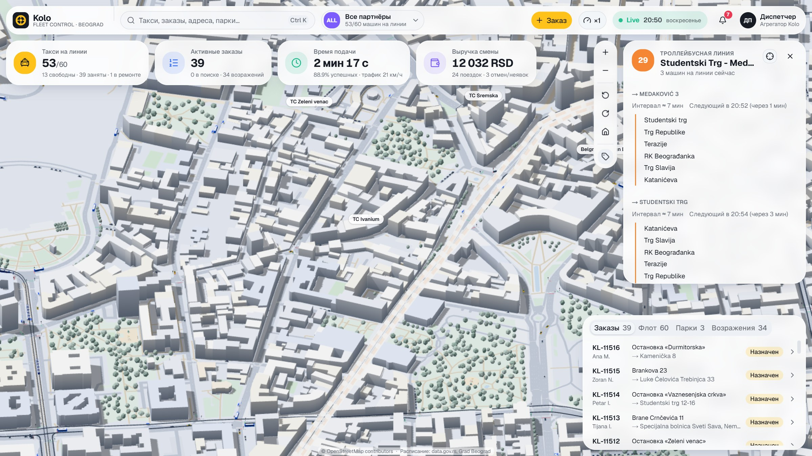
</p>
<p align="center">
  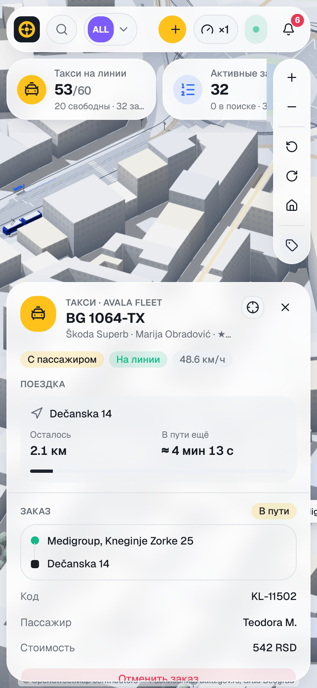
</p>

## ✨ Главное

### Настоящий город, собранный офлайн из открытых данных
- **6 300 зданий из OSM** выдавлены на реальную высоту; сетка окон в шейдере следует настоящей высоте этажа каждого дома.
- **Дорожный граф из `highway` OSM**: число полос, односторонки, `turn:lanes`, около 400 запретов поворотов, `maxspeed`, выделенки, кольца, мосты и тоннели **по уровням** с пандусами, опорами и парапетами.
- **282 светофора → 101 регулируемый перекрёсток**, знаки «уступи дорогу» и STOP, а где знаков нет — правило правой руки.
- **916 размеченных переходов**, парки, деревья, детские площадки, Сава, пешеходные улицы и дорожки.
- Один версионированный **файл района** (~2,8 МБ) общий для сервера и браузера, поэтому по сети ходит только то, что движется.

### Трафик, который ведёт себя правдоподобно
- Модель следования **IDM** с индивидуальными параметрами водителя и ограничением скорости в повороте.
- Перестроения **MOBIL** с вежливостью к задним соседям, подготовкой к повороту и мигающими в 3D поворотниками.
- Заранее посчитанные конфликты в узлах, «не въезжай на занятый перекрёсток», уступка при левом повороте, полная остановка у STOP, логика жёлтого и разблокировка взаимных тупиков.
- До **300 фоновых машин**; 10-минутный прогон без коллизий и дедлоков.

### Общественный транспорт по настоящему расписанию
- **GTFS ГСП Белграда** (data.gov.rs): в рамке около 110 автобусных, 6 троллейбусных и 10 трамвайных линий, около 22 000 рейсов в будний день.
- Выпуск по расписанию на **часах Белграда** с сервисами будней, субботы, воскресенья и праздников; праздники Сербии считаются сами, включая православную Пасху.
- **Трамваи** идут по реальным путям: CAF Urbos 3 (5 секций) и Tatra KT4, рельсы, балласт, провод и платформы. Там, где путь лежит в проезжей части, трамвай делит полосу с машинами.
- **Троллейбусы** с двумя штангами под реальной контактной сетью `trolley_wire`. Карманы остановок взяты из OSM или достроены эвристикой; автобус без кармана стоит в полосе, а машины объезжают его перестроением.
- Остановка показывает ближайшие отправления, линия — оба направления, остановки, медианный интервал и машины на линии, каждая машина — «по расписанию / опаздывает на N мин».

### Агрегатор такси, который действительно распределяет заказы
- **60 такси трёх партнёров** в реальных дворах: водители, рейтинги, сервисные боксы, поломки и ремонт.
- **Спрос взвешивается по самому городу**: остановки по числу рейсов за текущий час, точки притяжения по типу, адреса по площади этажей.
- Полный жизненный цикл заказа: поиск → предложение (15% пропускаются) → назначение → подача → поездка → завершение, плюс отмена, неявка, истечение и **возражения пассажиров** с возвратом средств.
- Тариф в RSD (посадка + км + минута), живой ETA и прогресс плеча по пробегу.

### Консоль диспетчера
- Клик по такси показывает маршрут, пины A/B, ETA, заказ, пассажира, стоимость и пошаговый трекер.
- Админ-действия: создать, назначить или отменить заказ; сменить статус машины; разрешить возражение; включить жёлтый мигающий или удерживать фазу светофора; менять скорость симуляции, плотность трафика и спрос.
- **Поиск Ctrl+K** по такси, заказам, паркам, линиям, остановкам и адресам; фильтр партнёра, который выцветает чужие машины; живая лента событий и KPI.
- Адаптив от десктопа до телефона, где инспектор открывается нижним листом.

### Сделано, чтобы оставаться быстрым
- LOD, отсечение и инстансинг снизили нагрузку кадра с **3,2 млн треугольников до 0,44–0,78 млн**; шаг серверной симуляции стоит **~0,4–1,2 мс** при бюджете 16,7 мс.
- `pnpm perf --budget` валит прогон, если ракурс превышает бюджет draw calls или треугольников, а `road-audit` считает дефекты геометрии дорог и рисует карты сверху.

## 🧭 Как это устроено

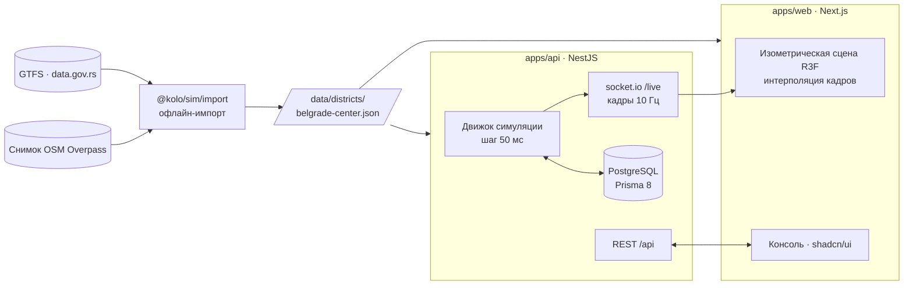

- **Сервер авторитетен.** `packages/sim` — детерминированный движок на чистом TypeScript без зависимостей. API крутит его, сохраняет бизнес-события (заказы, возражения, смены статусов) и рассылает компактные кадры.
- **Клиент строит тот же город** из того же файла района, интерполирует кадры 10 Гц в плавные 60 fps и опрашивает REST только за деталями выбранного объекта.
- **Данные офлайн.** OSM и GTFS импортируются один раз; в рантайме нет запросов к сторонним API.

## 🛠️ Технологии

| Слой | Технологии |
|---|---|
| Монорепо | pnpm 12 workspaces · Turborepo · TypeScript 6 |
| Фронтенд | Next.js 16 (App Router) · React 19 + React Compiler · Tailwind CSS 4 · shadcn/ui на Base UI · TanStack Query · Zustand |
| 3D | three.js · React Three Fiber · drei; ортографическая изометрическая камера, свои шейдеры, инстансинг, LOD |
| Бэкенд | NestJS 12 (ESM) · socket.io · zod |
| База данных | PostgreSQL 18 · Prisma ORM 8 (contract-first) |
| Симуляция | `@kolo/sim`: чистый TypeScript без runtime-зависимостей; IDM, MOBIL, Дейкстра по полосам, планы светофоров, планировщик GTFS |
| Тесты | Vitest · Node test runner · замер бюджета кадра через Playwright |
| Данные | OpenStreetMap (ODbL) · GTFS ГСП Белграда (Serbian Open Data License) |

## 🚀 Быстрый старт

**Нужно:** Node.js 25, pnpm 12, PostgreSQL 15+ на `localhost:5432`.

```bash
pnpm install

# Конфиг API: скопировать пример и при необходимости поправить DATABASE_URL
cp apps/api/.env.example apps/api/.env
createdb -U postgres kolo
pnpm --filter @kolo/api migrate      # применяет apps/api/migrations

pnpm dev                              # API на :4000, веб на :3000
```

Открой <http://localhost:3000>. Пустая база заполняется автоматически при первом старте
(партнёры, парки, 60 такси с водителями).

```bash
pnpm test     # все пакеты
pnpm build    # сборка всего
cd apps/web && pnpm perf --budget   # бюджет кадра, при запущенном pnpm dev
```

<details>
<summary>Пересборка района из сырых данных</summary>

Приложению достаточно закоммиченного `data/districts/belgrade-center.json`. Чтобы пересобрать его,
положи выгрузку Overpass и GTFS-фид ГСП в `data/raw/` (вне git) и запусти
`pnpm --filter @kolo/sim import:district`. `node packages/sim/scripts/road-audit.mjs --map` выводит
метрики геометрии дорог и рисует карты сверху.
</details>

## 📁 Структура репозитория

```
kolo/
├─ apps/
│  ├─ api/          NestJS: хост симуляции, шлюз socket.io, REST, контракт Prisma и миграции
│  └─ web/          Next.js: изометрическая сцена (components/scene) и консоль (components/console)
├─ packages/
│  ├─ sim/          сборка города, дорожный граф, трафик, транспорт, спрос, импорт (чистый TS)
│  └─ contracts/    общие enum'ы, wire-формат WebSocket, zod-схемы REST
├─ data/districts/  версионированный файл района Белграда
├─ docs/            документация для агента: архитектура, домен, дизайн, симуляция, роадмап
│  └─ superpowers/  дизайн-спека и десять планов реализации, по которым строился проект
└─ screenshots/
```

## 🤖 Как это сделано: оркестрация человеком и Claude Code

**В проекте нет ни строчки кода, написанной вручную.** Он собран **за 5 дней и 115 коммитов**:
около 19 тыс. строк TypeScript и 250+ тестов. Всё это сделал один человек, оркестрируя
[Claude Code](https://claude.com/claude-code) на модели **Claude Opus 5.5**.

Распределение ролей:

- **Человек — владелец продукта и оркестратор.** Он написал исходный бриф и принимал все продуктовые и
  архитектурные решения: настоящий Белград вместо процедурного города, транспорт по расписанию вместо
  недоступного GPS, стек, бренд. Он же проверял 3D-результат и разворачивал работу в нужную сторону.
- **Claude Code — инженерная команда.** Он исследовал источники данных, проектировал и писал код,
  покрывал его тестами, профилировал, визуально проверял результат и коммитил.

Процесс держался на плагине **[Superpowers](https://github.com/obra/superpowers)**, который навязывает
дисциплинированный цикл для каждого изменения:

1. **Brainstorming:** уточняющие вопросы и варианты, пока дизайн не согласован
   ([`docs/superpowers/specs`](docs/superpowers/specs)).
2. **Writing plans:** каждый этап разбит на маленькие задачи с тестами. Десять планов лежат в
   [`docs/superpowers/plans`](docs/superpowers/plans): дороги, места, транспорт, трамваи,
   производительность, спрос, приоритеты, перестроения, карманы остановок и геометрия дорог.
3. **Subagent-driven development:** задачи раздаются субагентам и проходят ревью между шагами
   (TDD, код-ревью, проверка перед завершением).
4. **Проверка доказательствами:** тесты, метрики `road-audit`, `perf --budget` и скриншоты headless
   Chrome через dev-хуки (`window.__koloUi`, `__koloFrames`, `__koloGl`).

Агент также работал с **официальными скилами** используемых инструментов:
[`shadcn`](https://ui.shadcn.com), [`react-best-practices`](https://github.com/vercel-labs/agent-skills)
от Vercel, `prisma-orm-setup` от Prisma и скилом `prisma-8`, который поставляется внутри
`@prisma/orm-postgres`. В репозиторий они не вендорятся: `skills-lock.json` фиксирует версии, а
`prisma skills sync` восстанавливает скил Prisma.

**Контекст переживает смену сессий** благодаря [`CLAUDE.md`](CLAUDE.md) и набору коротких документов
для агента в [`docs/`](docs). Каждый не длиннее 100 строк, без кода и без истории изменений. Источник
правды — чекбоксы в [`docs/ROADMAP.md`](docs/ROADMAP.md) и `git log`, поэтому любой новый чат продолжает
с того места, где остановился предыдущий, например после исчерпания лимитов.

## 🗺️ Что дальше

Идеи, которые ложатся на текущую архитектуру:

- **Эмулятор водителя:** принимать или пропускать предложения вручную из водительского вида размером с телефон.
- **Тепловая карта спроса и surge:** сетка ячеек спроса с коэффициентом цены.
- **День и ночь:** фары, светящиеся окна, кривые трафика и спроса по времени суток.
- **Роли и авторизация:** админ агрегатора, менеджер парка (видит только свой парк), диспетчер.
- **Телеметрия и replay:** хранить треки (TimescaleDB или партиционирование) и перематывать последний час вокруг спорного заказа.
- **Пешеходы** на 900+ реальных переходах, взаимодействующие с поворачивающими машинами.
- **Больше Белграда:** расширить рамку за Саву на Новый Белград и Земун; импорт и LOD уже рассчитаны на это.
- **Погода и инциденты:** дождь, замедляющий поток, перекрытия улиц и их влияние на ETA.
- **Реальные источники:** телематика партнёрских такси вместо симуляции и GPS транспорта, если ГСП когда-нибудь его откроет.
- **API и QA:** OpenAPI/Swagger для REST и Playwright-сценарии в CI.

## 📜 Лицензия и данные

Исходный код распространяется по [лицензии MIT](LICENSE).

Файл района построен на сторонних открытых данных:

- Картографические данные © [участники OpenStreetMap](https://www.openstreetmap.org/copyright), доступны
  по [Open Database License (ODbL)](https://opendatacommons.org/licenses/odbl/). Производная база района
  в `data/districts/` распространяется по той же лицензии.
- Расписание: GTFS «Градски јавни превоз у Београду», Град Белград, через
  [data.gov.rs](https://data.gov.rs), по Serbian Open Data License.

Партнёры, водители, пассажиры и заказы вымышлены. Kolo — демо и не связан с ГСП Белграда, Яндексом,
Uber или какими-либо таксомоторными компаниями.
